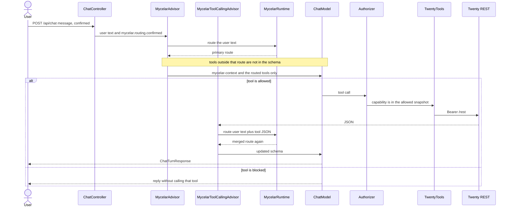

# mycelar-example-twenty

Spring AI sample: Mycelar routes a chat turn through a Twenty CRM sales-core graph, then exposes only the allowed tools as Bearer REST calls.

Requires a sibling checkout of [mycelar](https://github.com/jplucinski/mycelar).

## What it demonstrates

- `MycelarAdvisor` puts only the routed tools on the prompt. `TwentyTools` has 15 methods; a people lookup registers `searchPeople` and `getPerson`.
- `MycelarGraph` for Twenty people / companies / opportunities / notes
- `createNote` stays off that list until `confirmed=true`, even when the route reaches notes
- No MCP, no UI

## Requirements

- Java 21
- Docker (for `TwentyClientTest` via Testcontainers + `twentycrm/twenty-app-dev`)
- Twenty workspace + API key for `bootRun` (Settings → API & Webhooks)
- An OpenAI-compatible key for `ChatModel` (`OPENAI_API_KEY`)

```mermaid
flowchart TD
  twenty["twenty"] --> people["people"]
  twenty --> companies["companies"]
  twenty --> opportunities["opportunities"]
  twenty --> notes["notes"]

  people --> peopleRead["people-read"]
  people --> peopleWrite["people-write"]
  people --> peopleContext["people-context"]
  people -.-> personProfile["person-profile"]
  peopleRead --> searchPeople["search-people"]
  peopleRead --> getPerson["get-person"]
  peopleWrite --> createPerson["create-person"]
  peopleWrite --> updatePerson["update-person"]
  peopleContext --> personProfile

  companies --> companiesRead["companies-read"]
  companies --> companiesWrite["companies-write"]
  companiesRead --> searchCompanies["search-companies"]
  companiesRead --> getCompany["get-company"]
  companiesWrite --> createCompany["create-company"]
  companiesWrite --> updateCompany["update-company"]

  opportunities --> opportunitiesRead["opportunities-read"]
  opportunities --> opportunitiesWrite["opportunities-write"]
  opportunitiesRead --> searchOpportunities["search-opportunities"]
  opportunitiesRead --> getOpportunity["get-opportunity"]
  opportunitiesWrite --> createOpportunity["create-opportunity"]
  opportunitiesWrite --> updateOpportunity["update-opportunity"]

  notes --> notesRead["notes-read"]
  notes --> notesWrite["notes-write"]
  notes --> notesContext["notes-context"]
  notes -.-> communicationPolicy["communication-policy"]
  notesRead --> searchNotes["search-notes"]
  notesRead --> getNote["get-note"]
  notesWrite --> createNote["create-note"]
  createNote ==> confirmBeforeSend["confirm-before-send"]
  notesContext --> communicationPolicy

  peopleRead -->|RELATES_TO| peopleWrite
  peopleRead -->|RELATES_TO| notesWrite
  companiesRead -->|RELATES_TO| companiesWrite
  opportunitiesRead -->|RELATES_TO| opportunitiesWrite
```

## Run

```bash
export TWENTY_BASE_URL=https://api.twenty.com   # or https://your-host
export TWENTY_API_KEY=...
export OPENAI_API_KEY=...
./gradlew bootRun
```

```bash
curl -s http://localhost:8080/api/chat \
  -H 'content-type: application/json' \
  -d '{"message":"search people named Ada","confirmed":false}'
```

That turn registers `searchPeople` and `getPerson`. The other 13 methods stay off the schema. `confirmed` does not choose this set.

A sentence that names two steps still gets one primary path. "Find Ada and update her email" registers `createPerson` and `updatePerson`. "Find Ada and add a note" stays on notes: with `confirmed` false the schema is empty, and with `confirmed` true it is only `createNote`.

```bash
curl -s http://localhost:8080/api/chat \
  -H 'content-type: application/json' \
  -d '{"message":"find Ada and add a note","confirmed":false}'

curl -s http://localhost:8080/api/chat \
  -H 'content-type: application/json' \
  -d '{"message":"find Ada and add a note","confirmed":true}'
```

## Tests

```bash
./gradlew test
```

`TwentyClientTest` starts `twentycrm/twenty-app-dev` in Docker (same image Twenty uses in CI) and calls the real `/rest` API with the seeded dev token. The first run can take **15–25 minutes** while the image migrates its embedded database; later runs are faster. Other tests use mocks or the in-memory graph. Chat tests use a fake `ChatModel` and do not call OpenAI.

Without Docker, Testcontainers skips `TwentyClientTest` automatically. Docker Engine **29+** needs Testcontainers **1.21.4+** (this project sets `api.version=1.44` on the test JVM). On Windows, `src/test/resources/testcontainers.properties` points at `npipe:////./pipe/dockerDesktopLinuxEngine`; change it if your Docker context uses another pipe.

## Graph

`twenty` contains people, companies, opportunities, and notes. Each resource contains `read` and `write` nodes, and people and notes also contain `context`. Those nodes contain the capabilities, whose `operationId` equals the Spring AI tool name. The prompt receives the capabilities on the primary path, plus capability children of the groups on that path. Solid arrows are `CONTAINS`, dotted arrows are `EXPANDS_TO`, the thick arrow is `REQUIRES`, and labeled arrows are `RELATES_TO`. `REQUIRES` can still drop a reached capability: `create-note` stays blocked until `mycelar.routing.confirmed=true`.



## Chat turn

`POST /api/chat` puts the user text on the prompt and `confirmed` on `mycelar.routing.confirmed`. `MycelarAdvisor` routes that text and replaces the tool list with the primary route's allowed capabilities. A people search is two tools, not fifteen. A capability the route did not reach is absent. A reached capability that is blocked, such as `create-note` when `confirmed` is false, is described in `<mycelar-context>` and is not registered either.



## Spring AI alone

Attach `twentyToolCallbackProvider` with `.tools()` or `defaultTools` and leave out `MycelarAdvisor`. All 15 `@Tool` methods on `TwentyTools` are then on every prompt, including writes the user did not ask for.

This sample's controller does not call `.tools()` itself. `MycelarAdvisor` is what replaces that list with the routed subset.

## Graph versus the flat tool list

A flat `@Tool` list has no path, so `search people named Ada` still offers company, opportunity, and note tools. The graph walk keeps the schema on the matched group: `people-read` contributes `searchPeople` and `getPerson`. `REQUIRES` is a second cut inside that schema. It is not a walk edge, so `create-note` can be on the path and still stay unregistered until `confirmed` is true.
