# mycelar-example-twenty

Spring AI sample: Mycelar routes a chat turn through a Twenty CRM sales-core graph, then exposes only the allowed tools as Bearer REST calls.

Requires a sibling checkout of [mycelar](https://github.com/jplucinski/mycelarus) at `../mycelar` (Gradle `includeBuild`). The directory name on disk is `mycelar`; the GitHub repo is `mycelarus`.

## What it demonstrates

- `MycelarGraph` for Twenty people / companies / opportunities / notes
- `MycelarAdvisor` on Spring AI `ChatClient`
- `createNote` gated until `confirmed=true`
- No MCP, no UI

## Requirements

- Java 21
- Docker (for `TwentyClientTest` via Testcontainers + `twentycrm/twenty-app-dev`)
- Twenty workspace + API key for `bootRun` (Settings → API & Webhooks)
- An OpenAI-compatible key for `ChatModel` (`OPENAI_API_KEY`)

```mermaid
flowchart TD
  twenty["twenty"] --> people["people"]
  twenty --> companies["companies"]
  twenty --> opportunities["opportunities"]
  twenty --> notes["notes"]

  people --> peopleRead["people-read"]
  people --> peopleWrite["people-write"]
  people --> peopleContext["people-context"]
  people -.-> personProfile["person-profile"]
  peopleRead --> searchPeople["search-people"]
  peopleRead --> getPerson["get-person"]
  peopleWrite --> createPerson["create-person"]
  peopleWrite --> updatePerson["update-person"]
  peopleContext --> personProfile

  companies --> companiesRead["companies-read"]
  companies --> companiesWrite["companies-write"]
  companiesRead --> searchCompanies["search-companies"]
  companiesRead --> getCompany["get-company"]
  companiesWrite --> createCompany["create-company"]
  companiesWrite --> updateCompany["update-company"]

  opportunities --> opportunitiesRead["opportunities-read"]
  opportunities --> opportunitiesWrite["opportunities-write"]
  opportunitiesRead --> searchOpportunities["search-opportunities"]
  opportunitiesRead --> getOpportunity["get-opportunity"]
  opportunitiesWrite --> createOpportunity["create-opportunity"]
  opportunitiesWrite --> updateOpportunity["update-opportunity"]

  notes --> notesRead["notes-read"]
  notes --> notesWrite["notes-write"]
  notes --> notesContext["notes-context"]
  notes -.-> communicationPolicy["communication-policy"]
  notesRead --> searchNotes["search-notes"]
  notesRead --> getNote["get-note"]
  notesWrite --> createNote["create-note"]
  createNote ==> confirmBeforeSend["confirm-before-send"]
  notesContext --> communicationPolicy

  peopleRead -->|RELATES_TO| peopleWrite
  peopleRead -->|RELATES_TO| notesWrite
  companiesRead -->|RELATES_TO| companiesWrite
  opportunitiesRead -->|RELATES_TO| opportunitiesWrite
```

## Run

```bash
export TWENTY_BASE_URL=https://api.twenty.com   # or https://your-host
export TWENTY_API_KEY=...
export OPENAI_API_KEY=...
./gradlew bootRun
```

```bash
curl -s http://localhost:8080/api/chat \
  -H 'content-type: application/json' \
  -d '{"message":"search people named Ada","confirmed":false}'
```

"Find Ada and add a note" with `confirmed` false can search and leaves `createNote` out of the schema; the same two steps with `confirmed` true include it.

```bash
curl -s http://localhost:8080/api/chat \
  -H 'content-type: application/json' \
  -d '{"message":"find Ada and add a note","confirmed":false}'

curl -s http://localhost:8080/api/chat \
  -H 'content-type: application/json' \
  -d '{"message":"find Ada and add a note","confirmed":true}'
```

## Tests

```bash
./gradlew test
```

`TwentyClientTest` starts `twentycrm/twenty-app-dev` in Docker (same image Twenty uses in CI) and calls the real `/rest` API with the seeded dev token. The first run can take **15–25 minutes** while the image migrates its embedded database; later runs are faster. Other tests use mocks or the in-memory graph. Chat tests use a fake `ChatModel` and do not call OpenAI.

Without Docker, Testcontainers skips `TwentyClientTest` automatically. Docker Engine **29+** needs Testcontainers **1.21.4+** (this project sets `api.version=1.44` on the test JVM). On Windows, `src/test/resources/testcontainers.properties` points at `npipe:////./pipe/dockerDesktopLinuxEngine`; change it if your Docker context uses another pipe.

## Graph

`twenty` contains people, companies, opportunities, and notes. Each resource contains `read` and `write` nodes, and people and notes also contain `context`. Those nodes contain the capabilities, whose `operationId` equals the Spring AI tool name. Solid arrows are `CONTAINS`, dotted arrows are `EXPANDS_TO`, the thick arrow is `REQUIRES`, and labeled arrows are `RELATES_TO`. Creating a note stays blocked until advisor context `mycelar.routing.confirmed=true`.



## Chat turn

`POST /api/chat` puts the user text on the prompt and `confirmed` on `mycelar.routing.confirmed`. `MycelarAdvisor` routes that text through the graph, keeps only the allowed capabilities, and the model can call only those tools. A blocked capability, such as `create-note` when `confirmed` is false, is described in the prompt and is not registered as a tool.

```mermaid
sequenceDiagram
  actor User
  participant Chat as ChatController
  participant Advisor as MycelarAdvisor
  participant Loop as MycelarToolCallingAdvisor
  participant Runtime as MycelarRuntime
  participant Model as ChatModel
  participant Guard as Authorizer
  participant Tool as TwentyTools
  participant API as Twenty REST

  User->>Chat: POST /api/chat message, confirmed
  Chat->>Advisor: user text and mycelar.routing.confirmed
  Advisor->>Runtime: route the user text
  Runtime-->>Advisor: merged candidates
  Note over Advisor,Model: a blocked tool is not in the schema
  Advisor->>Model: mycelar-context and allowed tools only
  alt tool is allowed
    Model->>Guard: tool call
    Guard->>Tool: capability is in the allowed snapshot
    Tool->>API: Bearer /rest
    API-->>Loop: JSON
    Loop->>Runtime: route user text plus tool JSON
    Runtime-->>Loop: merged route again
    Loop->>Model: updated schema
    Model-->>User: ChatTurnResponse
  else tool is blocked
    Model-->>User: reply without calling that tool
  end
```

## Spring AI alone

Attach `twentyToolCallbackProvider` with `.tools()` or `defaultTools` and leave out `MycelarAdvisor`. Every `@Tool` on `TwentyTools` is then on the prompt. `confirmed` does not filter that list, so `createNote` is offered on every turn.

This sample's controller does not call `.tools()` itself. `MycelarAdvisor` is what puts the per-turn subset on the prompt.

## Graph versus the flat tool list

The `read` and `write` nodes are the tool boundary. Scope is the capabilities on the winning path plus the direct `CONTAINS` children of type `CAPABILITY`. `people` contains groups, so that node alone grants no tools. `people-read` grants `search-people` and `get-person`. `people-write` grants create and update. Companies, opportunities, and notes use the same cut. `REQUIRES` is not a walk edge: `create-note` stays out of the schema until `confirmed` is true.

A hit is a smaller schema plus a group instruction. The model still receives the `@Tool` name, description, and parameters for the capabilities in scope, and it also receives the capsules of the nodes on the path. `people-read` adds one sentence for that pair: search when you have a name or email, and call get only with an id already retrieved. Spring's flat list describes each tool on its own and sends all fifteen definitions on every turn. Nothing in that list appears only when the turn is about reading people.

The group sentence does not choose the branch. The default matcher scores Jaccard overlap of the intent with the node id, label, description, aliases, and keywords. Capsule text is attached after the path wins, for the model.

With top-k 2, "find Ada and add a note" can carry `people-read` and `notes-write` on the first turn, and `create-note` stays out of the schema until `confirmed` is true. After a tool result, the next model call is scored from the user text plus that JSON. With the provider attached directly, the model sees every tool, and `confirmed` never removes `createNote`.

The graph is the right mechanism when a tool must be absent from the schema, or when the catalog is large enough that sending every definition costs tokens and mixes resources. This sample has fifteen tools. The flat Spring list is enough to choose among them. The graph still supplies the confirmation gate: with `confirmed=false`, `createNote` is not offered at all.

## Several tools in one loop

The demo sets `mycelar.spring-ai.top-k` to 2, so one turn can carry tools from two groups. `people-read` relates to `people-write` and to `notes-write`. The company and opportunity read groups relate to their own write groups. A sentence that names both steps gets both groups on the first route. `create-note` stays blocked until `confirmed` is true.

The second model call is scored from the user text plus the tool JSON. A `searchPeople` result by itself does not add the write group.
