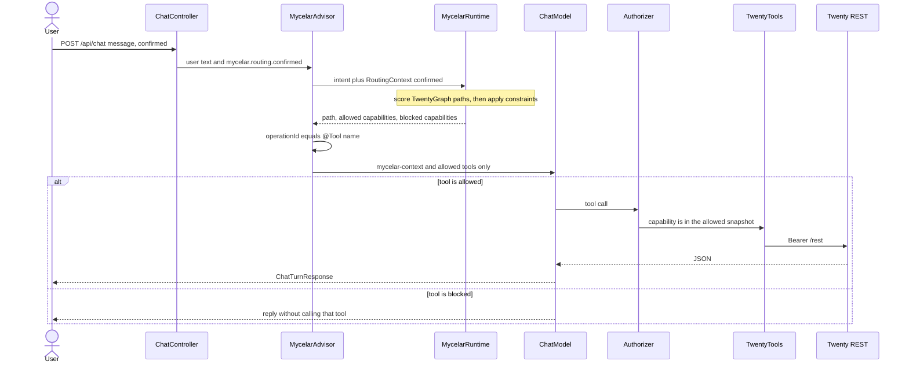
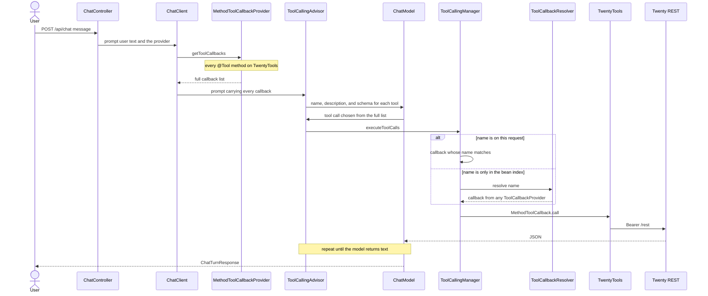

# mycelar-example-twenty

Spring AI sample: Mycelar routes a chat turn through a Twenty CRM sales-core graph, then exposes only the allowed tools as Bearer REST calls.

Requires a sibling checkout of [mycelar](https://github.com/jplucinski/mycelarus) at `../mycelar` (Gradle `includeBuild`). The directory name on disk is `mycelar`; the GitHub repo is `mycelarus`.

## What it demonstrates

- `MycelarGraph` for Twenty people / companies / opportunities / notes
- `MycelarAdvisor` on Spring AI `ChatClient`
- `createNote` gated until `confirmed=true`
- No MCP, no UI

## Requirements

- Java 21
- Docker (for `TwentyClientTest` via Testcontainers + `twentycrm/twenty-app-dev`)
- Twenty workspace + API key for `bootRun` (Settings → API & Webhooks)
- An OpenAI-compatible key for `ChatModel` (`OPENAI_API_KEY`)

## Run

```bash
export TWENTY_BASE_URL=https://api.twenty.com   # or https://your-host
export TWENTY_API_KEY=...
export OPENAI_API_KEY=...
./gradlew bootRun
```

```bash
curl -s http://localhost:8080/api/chat \
  -H 'content-type: application/json' \
  -d '{"message":"search people named Ada","confirmed":false}'
```

Creating a note is blocked until:

```bash
curl -s http://localhost:8080/api/chat \
  -H 'content-type: application/json' \
  -d '{"message":"create a note about the deal","confirmed":true}'
```

## Tests

```bash
./gradlew test
```

`TwentyClientTest` starts `twentycrm/twenty-app-dev` in Docker (same image Twenty uses in CI) and calls the real `/rest` API with the seeded dev token. The first run can take **15–25 minutes** while the image migrates its embedded database; later runs are faster. Other tests use mocks or the in-memory graph. Chat tests use a fake `ChatModel` and do not call OpenAI.

Without Docker, Testcontainers skips `TwentyClientTest` automatically. Docker Engine **29+** needs Testcontainers **1.21.4+** (this project sets `api.version=1.44` on the test JVM). On Windows, `src/test/resources/testcontainers.properties` points at `npipe:////./pipe/dockerDesktopLinuxEngine`; change it if your Docker context uses another pipe.

## Graph

`twenty` contains people, companies, opportunities, and notes. Each resource contains `read` and `write` nodes, and people and notes also contain `context`. Those nodes contain the capabilities, whose `operationId` equals the Spring AI tool name. Solid arrows are `CONTAINS`, dotted arrows are `EXPANDS_TO`, and the thick arrow is `REQUIRES`. Creating a note stays blocked until advisor context `mycelar.routing.confirmed=true`.

```mermaid
flowchart TD
  twenty["twenty"] --> people["people"]
  twenty --> companies["companies"]
  twenty --> opportunities["opportunities"]
  twenty --> notes["notes"]

  people --> peopleRead["people-read"]
  people --> peopleWrite["people-write"]
  people --> peopleContext["people-context"]
  people -.-> personProfile["person-profile"]
  peopleRead --> searchPeople["search-people"]
  peopleRead --> getPerson["get-person"]
  peopleWrite --> createPerson["create-person"]
  peopleWrite --> updatePerson["update-person"]
  peopleContext --> personProfile

  companies --> companiesRead["companies-read"]
  companies --> companiesWrite["companies-write"]
  companiesRead --> searchCompanies["search-companies"]
  companiesRead --> getCompany["get-company"]
  companiesWrite --> createCompany["create-company"]
  companiesWrite --> updateCompany["update-company"]

  opportunities --> opportunitiesRead["opportunities-read"]
  opportunities --> opportunitiesWrite["opportunities-write"]
  opportunitiesRead --> searchOpportunities["search-opportunities"]
  opportunitiesRead --> getOpportunity["get-opportunity"]
  opportunitiesWrite --> createOpportunity["create-opportunity"]
  opportunitiesWrite --> updateOpportunity["update-opportunity"]

  notes --> notesRead["notes-read"]
  notes --> notesWrite["notes-write"]
  notes --> notesContext["notes-context"]
  notes -.-> communicationPolicy["communication-policy"]
  notesRead --> searchNotes["search-notes"]
  notesRead --> getNote["get-note"]
  notesWrite --> createNote["create-note"]
  createNote ==> confirmBeforeSend["confirm-before-send"]
  notesContext --> communicationPolicy
```



## Chat turn

`POST /api/chat` puts the user text on the prompt and `confirmed` on `mycelar.routing.confirmed`. `MycelarAdvisor` routes that text through the graph, keeps only the allowed capabilities, and the model can call only those tools. A blocked capability, such as `create-note` when `confirmed` is false, is described in the prompt and is not registered as a tool.



## Spring AI alone

The same `POST /api/chat` with the `ToolCallbackProvider` attached directly, and no `MycelarAdvisor`. `MethodToolCallbackProvider` reflects every `@Tool` on `TwentyTools`. `ToolCallingAutoConfiguration` indexes those callbacks by name in `ToolCallbackResolver`. `ChatClient` copies the whole list onto the prompt, `OpenAiChatModel` sends every definition, and the model picks a tool from that list. `ToolCallingAdvisor` asks `ToolCallingManager` to run it: match the name on the request, or fall back to the resolver, then call the Java method. `confirmed` never filters the list, so `createNote` is callable on every turn.

This sample's controller does not call `.tools()` itself. `MycelarAdvisor` is what puts a per-turn subset on the prompt. The diagram is the Spring path when the provider is attached with `.tools(twentyToolCallbackProvider)` or `defaultTools`.



## Graph versus the flat tool list

The `read` and `write` nodes are the tool boundary. Scope is the capabilities on the winning path plus the direct `CONTAINS` children of type `CAPABILITY`. `people` contains groups, so that node alone grants no tools. `people-read` grants `search-people` and `get-person`. `people-write` grants create and update. Companies, opportunities, and notes use the same cut. `REQUIRES` is not a walk edge: `create-note` stays out of the schema until `confirmed` is true.

A hit is a smaller schema plus a group instruction. The model still receives the `@Tool` name, description, and parameters for the capabilities in scope, and it also receives the capsules of the nodes on the path. `people-read` adds one sentence for that pair: search when you have a name or email, and call get only with an id already retrieved. Spring's flat list describes each tool on its own and sends all fifteen definitions on every turn. Nothing in that list appears only when the turn is about reading people.

The group sentence does not choose the branch. The default matcher scores Jaccard overlap of the intent with the node id, label, and keywords. Capsule text is attached after the path wins, for the model.

`MycelarAdvisor` runs once, before `ToolCallingAdvisor` starts the tool loop, so that subset stays fixed for the turn. "Find Ada and add a note" follows the people-read branch or the notes-write branch. With the provider attached directly, the model sees every tool and can call `searchPeople` and then `createNote` before it answers.

The graph is the right mechanism when a tool must be absent from the schema, or when the catalog is large enough that sending every definition costs tokens and mixes resources. This sample has fifteen tools. The flat Spring list is enough to choose among them. The graph still supplies the confirmation gate: with `confirmed=false`, `createNote` is not offered at all.

## Several tools in one loop

Three gaps keep a turn on one group. "Find Ada and add a note", and "search Ada, then update her email", each need two groups. The loop can call only the tools from the first route.

`mycelar.spring-ai.top-k` is `1`, and `MycelarAdvisor` keeps `RouteResult.primary()` even when more candidates come back. Raise `top-k` and merge those candidates: union the allowed capabilities and the capsules, and if any candidate blocks a capability, leave it blocked. One sentence that names people and a note can then carry `people-read` and `notes-write` together. `create-note` still waits for `confirmed=true`.

A `CONTAINS` chain cannot hold sibling groups. `people-read` and `people-write` are both children of `people`, so search-then-update never shares a path, and the one-hop scope never grants both pairs. Add `RELATES_TO` from `people-read` to `people-write`, and from `people-read` to `notes-write`, for a sentence that names both steps. The walker already follows `RELATES_TO`, and scope includes the capability children of every node on that path. A longer path pays the default path penalty (`pathPenaltyAlpha` 0.05), so the link wins when the sentence matches both ends. It stays idle when the second tool appears only after a tool result.

The loop still reuses the first tool list. `ToolCallingAdvisor` copies those callbacks onto every model call, and `MycelarAdvisor` has already returned. `MycelarRequestMapper` routes on the original user message. Route again before each model call, using that message plus the latest tool result, and replace the callback list. Keep the same `confirmed` flag, so the confirmation gate still applies after `searchPeople` returns an id.
