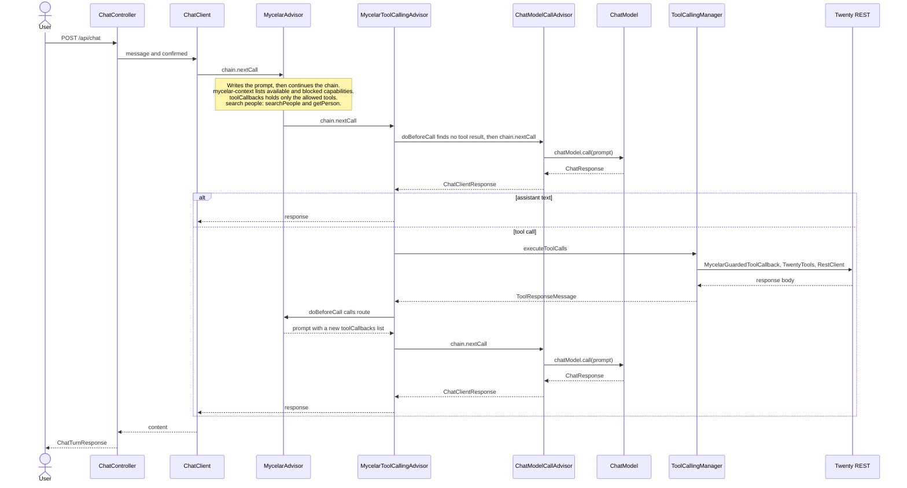

# mycelar-example-twenty

Spring AI sample for Twenty CRM. `TwentyTools` exposes 15 tools. Mycelar puts only the primary route on the prompt, so a people lookup sends `searchPeople` and `getPerson`.

Requires a sibling checkout of [mycelar](https://github.com/jplucinski/mycelar) at `../mycelar` (`includeBuild`). No MCP, no UI.

## What the prompt contains

`MycelarAdvisor` runs before the model. It writes two things into the request:

- `<mycelar-context>` in the system message lists available capabilities, and blocked ones
- `ToolCallingChatOptions.toolCallbacks` is the tool schema Spring sends with that same request

`search people named Ada` registers `searchPeople` and `getPerson`. The other 13 methods are absent. `confirmed` does not choose this set.

A sentence that names two steps still gets one primary path. `mycelar.spring-ai.top-k` is 2, and the advisor keeps `RouteResult.primary()`.

| User text | `confirmed` | Tools on the prompt |
| --- | --- | --- |
| search people named Ada | false | `searchPeople`, `getPerson` |
| find Ada and update her email | false | `createPerson`, `updatePerson` |
| find Ada and add a note | false | none; `create-note` is listed as blocked |
| find Ada and add a note | true | `createNote` |

`confirmed` is an advisor parameter, `mycelar.routing.confirmed`, not a tool argument. It only matters when the primary path reaches `create-note`. Until it is true, that capability stays in the context block and is not a callback.

```bash
curl -s http://localhost:8080/api/chat \
  -H 'content-type: application/json' \
  -d '{"message":"search people named Ada","confirmed":false}'
```

## Chat turn

`ChatController` calls Spring `ChatClient`. The client starts the advisor chain. `MycelarAdvisor` routes the user text, writes the prompt above, and calls `chain.nextCall`. `MycelarToolCallingAdvisor` does not call `ChatModel`. On the first pass `doBeforeCall` sees no tool result and also calls `chain.nextCall`. `ChatModelCallAdvisor` is the end of the chain and runs `chatModel.call(prompt)`. The tool list is already on that prompt.

If the model returns text, the loop stops. If it returns a tool call, `ToolCallingManager` runs `MycelarGuardedToolCallback`. The guard checks the snapshot, `TwentyTools` calls Twenty through `RestClient`, and the body comes back as a `ToolResponseMessage`. The next `doBeforeCall` calls `MycelarAdvisor.route` with the user text plus that response and replaces `toolCallbacks` before `ChatModelCallAdvisor` runs again.



## Without Mycelar

`TwentyConfiguration` builds `twentyToolCallbackProvider` and does not attach it in `ChatController`. The advisor chain is what puts tools on the prompt.

Attach that provider with `.tools()` or `defaultTools` and leave out `MycelarAdvisor`. All 15 `@Tool` methods are then on every request. `confirmed` does not remove `createNote`.

## Graph

`twenty` contains people, companies, opportunities, and notes. Each resource contains `read` and `write`, and people and notes also contain `context`. Those nodes contain the capabilities. `operationId` equals the Spring AI tool name.

The prompt receives capabilities on the primary path, including capability children of the groups on that path. `people-read` therefore contributes both `searchPeople` and `getPerson`.

Solid arrows are `CONTAINS`. Dotted arrows are `EXPANDS_TO`. The thick arrow is `REQUIRES`. Labeled arrows are `RELATES_TO`. `REQUIRES` is not walked: `create-note` can be on the path and still stay unregistered until `mycelar.routing.confirmed=true`.

```mermaid
flowchart TD
  twenty["twenty"] --> people["people"]
  twenty --> companies["companies"]
  twenty --> opportunities["opportunities"]
  twenty --> notes["notes"]

  people --> peopleRead["people-read"]
  people --> peopleWrite["people-write"]
  people --> peopleContext["people-context"]
  people -.-> personProfile["person-profile"]
  peopleRead --> searchPeople["search-people"]
  peopleRead --> getPerson["get-person"]
  peopleWrite --> createPerson["create-person"]
  peopleWrite --> updatePerson["update-person"]
  peopleContext --> personProfile

  companies --> companiesRead["companies-read"]
  companies --> companiesWrite["companies-write"]
  companiesRead --> searchCompanies["search-companies"]
  companiesRead --> getCompany["get-company"]
  companiesWrite --> createCompany["create-company"]
  companiesWrite --> updateCompany["update-company"]

  opportunities --> opportunitiesRead["opportunities-read"]
  opportunities --> opportunitiesWrite["opportunities-write"]
  opportunitiesRead --> searchOpportunities["search-opportunities"]
  opportunitiesRead --> getOpportunity["get-opportunity"]
  opportunitiesWrite --> createOpportunity["create-opportunity"]
  opportunitiesWrite --> updateOpportunity["update-opportunity"]

  notes --> notesRead["notes-read"]
  notes --> notesWrite["notes-write"]
  notes --> notesContext["notes-context"]
  notes -.-> communicationPolicy["communication-policy"]
  notesRead --> searchNotes["search-notes"]
  notesRead --> getNote["get-note"]
  notesWrite --> createNote["create-note"]
  createNote ==> confirmBeforeSend["confirm-before-send"]
  notesContext --> communicationPolicy

  peopleRead -->|RELATES_TO| peopleWrite
  peopleRead -->|RELATES_TO| notesWrite
  companiesRead -->|RELATES_TO| companiesWrite
  opportunitiesRead -->|RELATES_TO| opportunitiesWrite
```



## Run

- Java 21
- Twenty workspace and API key (Settings → API & Webhooks)
- An OpenAI-compatible key (`OPENAI_API_KEY`)

```bash
export TWENTY_BASE_URL=https://api.twenty.com   # or https://your-host
export TWENTY_API_KEY=...
export OPENAI_API_KEY=...
./gradlew bootRun
```

## Tests

```bash
./gradlew test
```

`TwentyClientTest` starts `twentycrm/twenty-app-dev` in Docker and calls `/rest` with the seeded dev token. The first run can take 15–25 minutes while the image migrates its database. Other tests use mocks or the in-memory graph. Chat tests use a fake `ChatModel` and do not call OpenAI.

Without Docker, Testcontainers skips `TwentyClientTest`. Docker Engine 29+ needs Testcontainers 1.21.4+ (this project sets `api.version=1.44` on the test JVM). On Windows, `src/test/resources/testcontainers.properties` points at `npipe:////./pipe/dockerDesktopLinuxEngine`.
